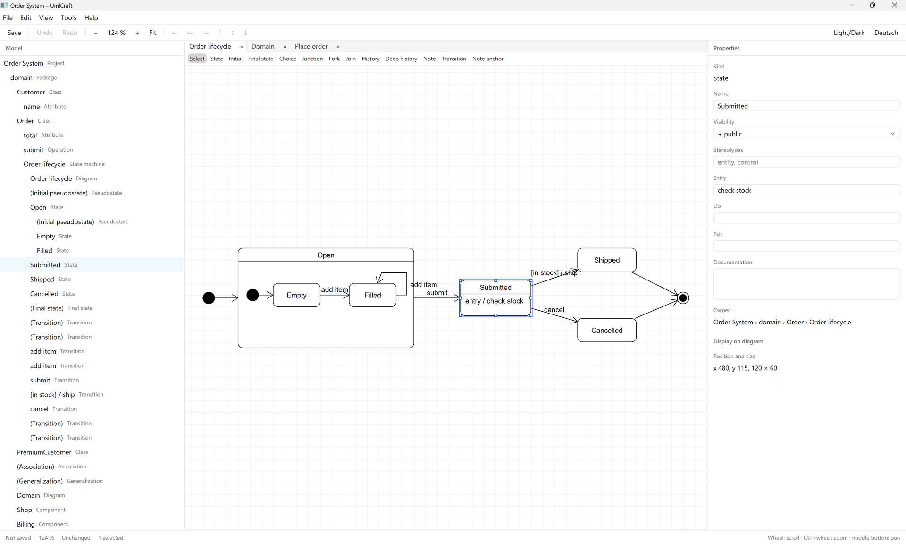

# UmlCraft

A UML modeling tool written in Rust with [GPUI](https://gpui.rs), built from scratch. It opens
and writes `.asta` project files and imports Java, C#, C++ and Python source code.



## Download

Releases for Windows (x64: installer and `.zip`), macOS (universal) and Linux (x64: `.deb`,
`.rpm`, AppImage, Flatpak, Snap and `.tar.gz`) are on the
[releases page](https://github.com/udvlp/UmlCraft/releases).
The builds are not signed yet; the release notes explain how to start them anyway. What changed
between releases is in the [changelog](CHANGELOG.md).

## Diagrams

| Diagram | What it covers |
| --- | --- |
| Class | Classes, interfaces (also as a circle), enumerations, packages and subsystems; attributes, operations and template parameters with bounds and defaults; associations with roles, multiplicities, navigability, aggregation, qualifiers and static ends; generalization, realization, dependency; containment lines (⊕) to nested classes; bound templates such as `Box<Holder, 20>`, also drawn as bound classes with their «bind» line |
| Object | Objects `name : Class` with a slot for every attribute of the class, inherited ones included; links with roles, navigability and aggregation, as instances of associations. They are drawn on class diagrams |
| Use case | Actors, use cases with extension points, system boundary, include and extend with condition, notes on lines |
| Sequence | Lifelines, synchronous, asynchronous, reply, create, destroy, self, found and lost messages, activation bars, message numbers, combined fragments (alt, opt, loop, par, …) with operands and guards, interaction uses |
| Activity | Actions, initial and final nodes, decision, merge, fork and join, object nodes (also in a state, `Order [filled]`), flows with guards, partitions (also nested) |
| State machine | States with entry, do, exit and internal transitions, composite states, orthogonal states with regions one below the other or side by side, final states, initial, choice, junction, fork, join and history pseudostates, transitions labeled `trigger [guard] / effect`. A state dragged into another state or region becomes part of it |
| Component and deployment | Components, artifacts and nodes with their icons, objects and instances, deployments |

Diagrams imported from `.asta` files keep their layout, sizes and colors.

## Files

- **Open `.asta` files** (File › Import .asta project, or simply open the file): Astah project
  files with the model, all diagram kinds above, positions, sizes, waypoints, line styles, notes,
  free texts and lines, and colors. Anything UmlCraft cannot represent yet is skipped and reported.
- **Export to `.asta`** (File › Export › .asta project …): writes `.asta` files through the
  official API of an installed Astah; without one the menu item explains what is missing. What
  the API cannot express is reported. See
  [docs/architecture.md](docs/architecture.md#asta-export).
- **Images** (File › Export › Diagram as SVG … / Diagram as PNG …): the open diagram. SVG keeps
  real text; PNG is rasterized at twice the canvas size.
- **Structograms** (File › New structogram, Open structogram …, Structogram from source file …):
  Nassi-Shneiderman diagrams in [Structorizer](https://structorizer.fisch.lu)'s `.nsd` format
  open in a window of their own, drawn line for line as Structorizer draws them (syntax
  highlighting off), and export as SVG or PNG. They are edited as in Structorizer: insert
  elements before or after the selection, edit text and comment in a dialog, cut, copy, paste,
  drag, colour, disable and delete them, add and remove branches, undo and redo. Files are read
  and written byte for byte as Structorizer 3.32-35 writes them. Methods of a Java or C# file
  become structograms without types, with assignments as `x := 42 + a`; what has no place in a
  structogram (`continue`, labels …) is listed.

## Importing source code

The ribbon's Tools tab imports source code (Import source code › Java, C#, C++ or Python, then
Files … or Folder …).

The Java import reads declarations from `.java` sources
into the open project: packages, classes, interfaces, enumerations,
records and annotation types with attributes, operations, template parameters, supertypes and
Javadoc. Library types become placeholders at their package path (`java › util › List`), and
fields typed by a model type become associations (`*`, `{ordered}`, `{unique}`, a qualifier for
map keys). Method bodies are skipped, files with syntax errors are reported, and importing again
updates the model instead of duplicating it. The whole import is one undo step; a project of
6,300 files takes about ten seconds.

The C# import does the same for `.cs` sources: namespaces,
classes, interfaces, structs, enumerations and records with fields, methods, constructors,
operators, template parameters with their `where` bounds, base classes and interfaces, and
`///` documentation. Auto-properties become attributes, properties with bodies and indexers
become accessor operations as .NET names them (`get_Count`, `set_Count`), and partial classes
become one class. Library types become placeholders at their namespace path
(`System › Collections › Generic › List`), and `Order?` becomes an association end `0..1`. Of
`#if` … `#else`, only the first branch is read.

The C++ import reads headers and sources (`.h`, `.hpp`,
`.cpp`, `.cc` …): namespaces, classes, structs, unions and enumerations with fields, member
functions, constructors, destructors, operators, template parameters, base classes, and `///`,
`//!` and `/** */` documentation. Pure virtual functions are abstract, `const` ones queries;
members defined outside their class (`void Order::ship() {}`) join the class, filling in
parameter names and documentation the header leaves out, and typedefs and `using` aliases are
replaced by what they stand for. Standard containers and smart pointers make associations
(`std::vector<Line>` `*`, `std::unique_ptr<T>` `1`, a raw pointer `0..1`). Of `#if`/`#ifdef`
… `#else`, only the first branch is read; macros are not expanded, so files that use them in
declarations (`class API Order`) are reported and left out.

The Python import reads `.py` and `.pyi` files:
every file is a module in the package of its folders (those with an `__init__.py`), with its
classes, their annotated attributes and the attributes `__init__` assigns to `self`, methods
without `self`, docstrings, and template parameters from `Generic[T]` or `class Box[T]:`.
`Protocol` classes become interfaces, `Enum` classes enumerations, `ABC` classes abstract;
`@staticmethod`, `@classmethod`, `@abstractmethod` and `@final` set their flags, and all
decorators are kept as a tagged value. What has no annotation gets no type and no association;
`list[Line]`, `dict[str, Line]`, `Optional[Line]` and `Line | None` make associations. Names
resolve through imports, relative imports and what a package's `__init__.py` imports.

## Editing

The window has its own title bar (File menu, Save, Undo, Redo, Settings) and a ribbon with the
tabs Home (clipboard, delete, align, line style), the open diagram's kind (its tools), View
(zoom, theme, language) and Tools (source import, exchange with `.asta` files, images). Model
tree, diagram and properties are cards beside each other. A double click on a ribbon tab folds
the ribbon to its tabs; in a narrow window its buttons show icons only.

Inline editing by double-click with a parser for `+ name : Type [0..*] = init` and
`+ op(p : T) : R`; a properties panel for everything else. Undo and redo for every change, copy,
cut and paste (as a copy or as the same elements), rubber-band and multiple selection, alignment,
waypoints, zoom to fit, drag and drop within the model tree and from the tree onto the canvas.
Free texts and lines on every diagram (Text and Line tools): texts edited in place, lines
dashed or with arrowheads, their ends dragged one by one. Light and dark theme, German and
English. Members show their visibility right before the name (`- name`); UmlCraft's
visibility column lines up all names of a compartment instead. Theme, language and the column
are chosen in the settings (the gear in the title bar, or Ctrl+,).

## Not yet supported

- Composite structure diagrams (ports, parts, connectors)
- More than two regions per state in the `.asta` export, because the API divides a state only
  once
- Data flow diagrams, flowcharts, communication, timing, requirement, ER
  and mind map diagrams and matrices in `.asta` files (skipped on import)
- Component and deployment diagrams are exported to `.asta` as class diagrams, because the API
  has no editors for them
- Containment lines in the `.asta` export, which the API cannot draw (they are imported)
- In the Python import: attributes assigned outside `__init__`, `@property` as an attribute,
  functions and variables outside classes
- In the C# import: modifiers such as `virtual`, `override` or `async` as tagged values,
  attributes, events and delegates
- In the C++ import: `virtual`, `override`, `inline` and the access of base classes as tagged
  values, macros, and functions and variables outside classes
- Code generation
- Signed builds

## Build and run

```bash
cargo run -p umlcraft-app
```

```bash
cargo test --workspace
```

On Debian/Ubuntu, GPUI needs some system libraries first:
`bash packaging/linux/install-build-deps.sh`.

## Releasing

1. Set the version in `Cargo.toml` (`workspace.package.version`), add the release to
   [CHANGELOG.md](CHANGELOG.md) and to the `<releases>` of
   `packaging/linux/com.umlcraft.app.metainfo.xml`, and commit.
2. Tag and push: `git tag v0.1.0 && git push origin v0.1.0`.
3. The [release workflow](.github/workflows/release.yml) checks that the tag and the metainfo
   match the version, builds the Windows `.zip` and installer (Inno Setup 7,
   `packaging/windows/umlcraft.iss`, tried out by installing and uninstalling it), the Linux
   `.tar.gz`, `.deb`, `.rpm`,
   `.AppImage`, `.flatpak` and `.snap` and the macOS `.dmg`, adds the third-party license
   notices (`cargo about`, configured in `about.toml`) and creates a draft release. The Linux
   packages are all made from the one Linux binary; their files are in `packaging/linux`.
4. Review the draft on GitHub, put a "What's new" section in front of its text and publish it.

Running the workflow by hand (Actions › Release › Run workflow) only builds the packages and
keeps them as workflow artifacts.

## Structure

| Crate | Purpose |
| --- | --- |
| `crates/umlcraft-model` | Metamodel, diagrams/presentations, `Op`, `Document`/`Tx` (undo/redo) |
| `crates/umlcraft-format` | `.ucraft` files: JSON, stably sorted, versioned |
| `crates/umlcraft-notation` | UML notation without UI: scene, hit testing, palettes, connection rules |
| `crates/umlcraft-asta` | Import of Astah `.asta` files; reads and writes their object graphs |
| `crates/umlcraft-asta-export` | Export to `.asta` through an installed Astah and its API |
| `tools/asta-export` | The Java tool behind the `.asta` export |
| `crates/umlcraft-reverse` | Source import (Java, C#, C++, Python): tree-sitter front-ends, a language-neutral IR, resolution and merging into the model |
| `tools/jdk-types` | The Java tool that writes the table of JDK types used by the Java import |
| `crates/umlcraft-nsd` | Structorizer's `.nsd` structograms: model, reading and writing, layout, drawing, SVG, editing |
| `crates/umlcraft-nsd-code` | Methods of source files as structograms (Java, C#; tree-sitter) |
| `tools/nsd-metrics` | The Java tool that writes the text metrics `umlcraft-nsd` lays structograms out with |
| `crates/umlcraft-app` | GPUI application (`gpui-kit` 0.8) |

Details: [docs/architecture.md](docs/architecture.md). Commands and project rules for
contributors: [CONTRIBUTING.md](CONTRIBUTING.md).

## License

UmlCraft is licensed under either of

- Apache License, Version 2.0 ([LICENSE-APACHE](LICENSE-APACHE))
- MIT license ([LICENSE-MIT](LICENSE-MIT))

at your option.

Unless you explicitly state otherwise, any contribution intentionally submitted for inclusion in
UmlCraft by you, as defined in the Apache-2.0 license, shall be dual licensed as above, without any
additional terms or conditions.

UmlCraft is an independent project and is not affiliated with Change Vision, Inc., the maker of
Astah. "Astah" is a trademark of Change Vision, Inc.
